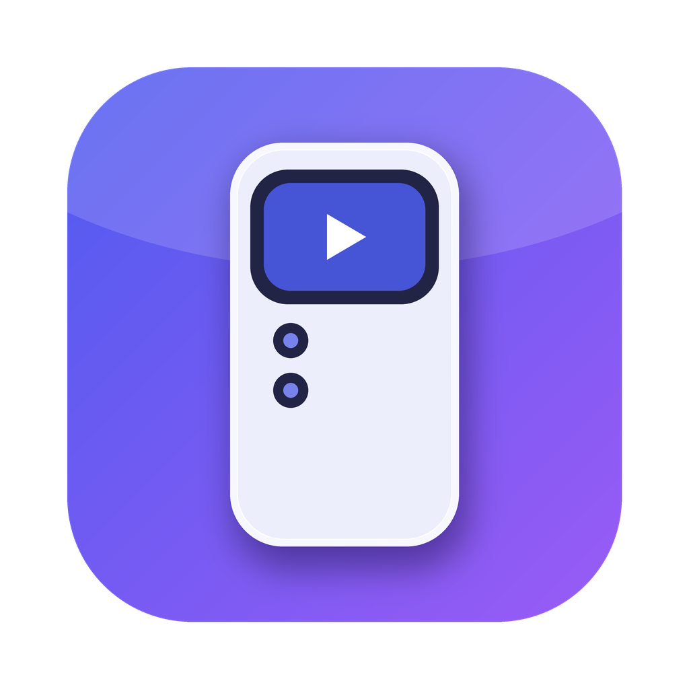
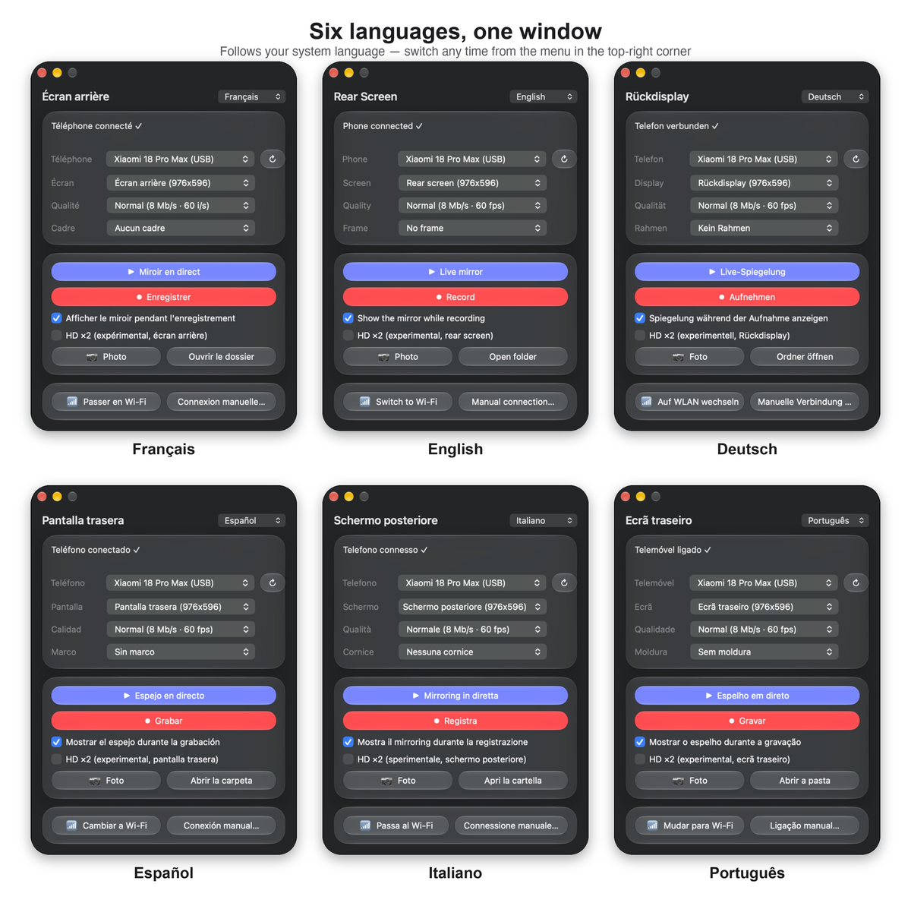
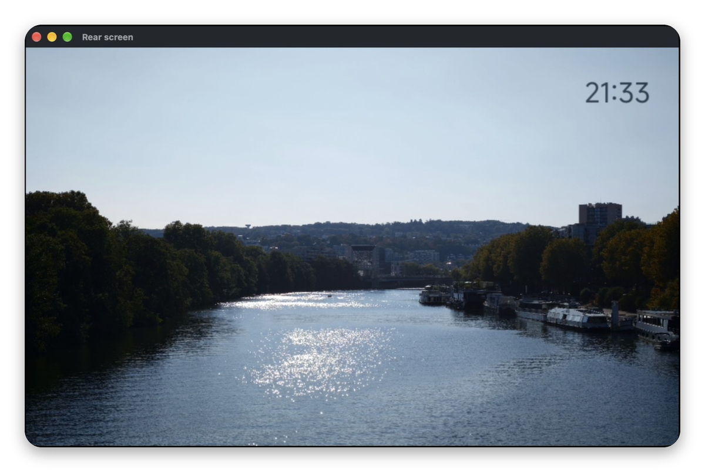

<div align="center">
<br />

</div>

<h1 align="center">Rear Screen</h1>

<br />

<div align="center">
  
  
  <a href="https://swift.org/">
    
  </a>
  <a href="https://dotnet.microsoft.com/">
    
  </a>
  <a href="https://github.com/Genymobile/scrcpy">
    
  </a>
  <br />
  <a href="LICENSE">
    
  </a>
  
  <br /><br />
  <a href="https://github.com/Nikodable/xiaomi-rear-screen/releases">
    
  </a>
  <a href="https://github.com/Nikodable/xiaomi-rear-screen/releases">
    
  </a>
</div>


<h4 align="center">Rear Screen is a free and open source app to mirror, record and photograph your Xiaomi phone's <strong>rear screen</strong> (and its front screen — or both at once) on your Mac or PC, over USB or Wi-Fi. One click, no command line, nothing else to install.</h4>

<div align="center">

# ⬇️ Download

<a href="https://github.com/Nikodable/xiaomi-rear-screen/releases/latest">
</a>
&nbsp;
<a href="https://github.com/Nikodable/xiaomi-rear-screen/releases/latest">
</a>
</div>

<div align="center">
    <p>
      <a href="macos/README.md"><strong>macOS install guide</strong></a> ·
      <a href="windows/README.md"><strong>Windows install guide</strong></a> ·
      <a href="CHANGELOG.md"><strong>Changelog</strong></a>
    </p>
    <p>The apps are not code-signed, so macOS and Windows show a warning on first launch — the install guides explain how to open them in two clicks.</p>
</div>

<hr />

<div align="center">
    
</div>

<div align="center">
    
</div>

<div align="center">
    
    <br />
    <sub>The phone's rear screen, mirrored live in its own window.</sub>
</div>

# ✨ Features

- 📺 Screens
  - Mirror the **rear screen**, the **front screen**, or **both at once**
  - Screens are named for you (Front / Rear / Main) — virtual displays are hidden
  - Works with single-screen phones too
- 🎬 Capture
  - **Record** to MP4 (one file per screen), with or without the live window
  - **Photo**: PNG screenshot of the selected screen(s)
  - Quality presets: Light / Normal / Max (up to 120 fps)
- 🖼️ **Phone frame** *(optional)*: show the rear screen inside a phone — live, in photos and in videos — with the camera module around it. Always starts on **No frame**; bring your own frame with a small tool ([docs/FRAMES.md](docs/FRAMES.md))
- 🔍 **HD ×2** *(experimental)*: doubles the rear screen's resolution for sharper text and widgets
- 📶 Wi-Fi
  - One-click switch from USB to wireless
  - Manual pairing with a code (Wireless debugging)
- 🌍 Six languages: Français, English, Deutsch, Español, Italiano, Português (follows your system, switchable in the app)
- 📱 Shows your phone's real name (e.g. “Xiaomi 18 Pro Max”) and gives clear help when something is wrong
- 🎨 Native look: Liquid Glass on macOS 26+, Mica on Windows 11, automatic light/dark theme
- <details><summary>🆓 Free and Open Source</summary>

  - MIT-licensed code; bundled scrcpy, adb and libraries keep their own licenses ([NOTICE](NOTICE))
  - Reproducible builds from this repository: [`macos/build.sh`](macos/build.sh), [`windows/build.sh`](windows/build.sh)
  - scrcpy is downloaded by [`scripts/fetch-scrcpy.sh`](scripts/fetch-scrcpy.sh) and verified against a pinned SHA-256
</details>

- <details><summary>🛡️ Privacy-friendly</summary>

  - No account, no analytics, no tracking, no automatic update check
  - The app only talks to your phone (over USB, or your local network in Wi-Fi mode)
  - Recordings and photos stay on your computer (`Movies/EcranArriere` on macOS, `Videos\EcranArriere` on Windows)
</details>

- <details><summary>🧪 HD ×2: how it works and what to know</summary>

  - Temporarily sets the rear display to twice its resolution (`wm size` / `wm density`), and restarts only the Xiaomi rear-screen service so its widgets re-layout
  - Needs **USB debugging (Security settings)** on the phone; off by default
  - The phone is restored automatically when the mirror/recording stops, when the app quits, and at next launch if a ×2 was left active
  - Only the rear screen is touched; a custom display setting made by you is never modified
  - Tested on a Xiaomi 18 Pro Max (HyperOS); other phones may behave differently
</details>


# 🚀 Quick start

1. **Download** the zip for your system from the [latest release](https://github.com/Nikodable/xiaomi-rear-screen/releases/latest) and open the app (first launch: see the install guide).
2. **Prepare the phone once**: Settings → About phone → tap the OS version 7 times → Developer options → turn on **USB debugging**, then plug it in and accept the prompt.
3. **Pick a screen, press Live mirror or Record.** That's it.


# 🛟 Help

* [macOS install guide & troubleshooting](macos/README.md)
* [Windows install guide & troubleshooting](windows/README.md)
* [Changelog](CHANGELOG.md)
* [Phone frames: use or create your own](docs/FRAMES.md)
* Something wrong? [Open an issue](https://github.com/Nikodable/xiaomi-rear-screen/issues) and tell us your phone model, your OS and what the app's status line says.


# 🧰 Build from source

```bash
git clone https://github.com/Nikodable/xiaomi-rear-screen.git && cd xiaomi-rear-screen

macos/build.sh      # needs Xcode Command Line Tools; output: macos/dist/
windows/build.sh    # needs the .NET SDK (brew install dotnet); cross-compiles from macOS/Linux; output: windows/dist/
```

The version number lives in the [`VERSION`](VERSION) file. Maintainers: see [docs/RELEASING.md](docs/RELEASING.md).

```
macos/       AppKit app (Swift, built with swiftc) + build script + icon
windows/     WPF app (C#, .NET) + build script
i18n/        one text catalog → generates Strings.swift and Strings.cs
scripts/     fetch-scrcpy.sh · make-icon.py · make-overview.py · make-languages.py · make-mirror.py · make-frame.py · make-custom-frame.py · release.sh
docs/        icon, screenshots, default phone frame (frame/), FRAMES.md, release notes for maintainers
third_party/ (not committed) downloaded scrcpy builds
```


# 🤝 Contribute

Pull requests are welcome. For larger changes, please open an issue first to discuss what you would like to change.

## Good first contributions
- 🧪 **Test on other phones** (other Xiaomi / Android devices with a second screen) and report what works
- 🪟 **Test the Windows version** on real hardware — it is cross-compiled from macOS, so feedback is very valuable
- 🌍 Proofread a translation (see below)

## Ideas being considered
- Intel build for macOS (the scrcpy archive exists; needs an x86_64 target)
- An optional “TV mode” using a high-quality scaler, for big screens
- An opt-in “update available” notice (deliberately **not** implemented yet)
- Apple notarization / Windows code signing, Homebrew cask and winget packages
- Automated builds with GitHub Actions

## Not planned
- Audio capture (scrcpy's audio is disabled on purpose)
- Anything that modifies the phone beyond the temporary, self-restoring HD ×2 setting


# 🌍 Translations

All texts live in one file: [`i18n/strings.py`](i18n/strings.py). To fix a translation or add a language:

1. Edit `strings.py` (add the language to `LANGS` and a value for every key).
2. Run `python3 i18n/generate.py` — it rewrites `macos/swift/Strings.swift` and `windows/Strings.cs`.
3. Rebuild and open a pull request.

Current translations were written by the maintainer and are open to proofreading by native speakers.


# ✉️ Contact us

* Bugs and feature ideas: [GitHub issues](https://github.com/Nikodable/xiaomi-rear-screen/issues)


# 📜 License

* [MIT](LICENSE) for this project's code.
* Bundled third-party software — [scrcpy](https://github.com/Genymobile/scrcpy) (Apache-2.0), adb, SDL, FFmpeg, libusb — keeps its own licenses: see [NOTICE](NOTICE).
* Rear Screen is an independent project, not affiliated with Xiaomi, Google or Genymobile. “Xiaomi” and “Android” are trademarks of their respective owners.
