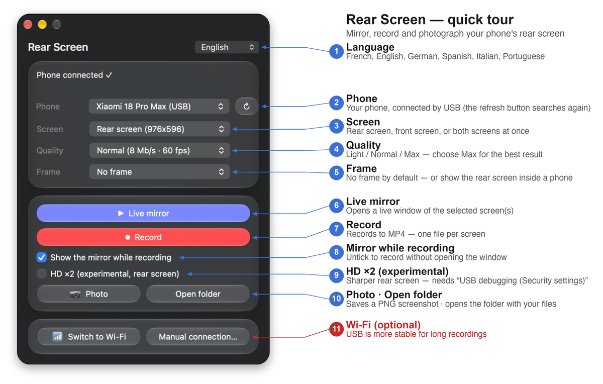

# Rear Screen — macOS install guide

Mirror, record and take photos of your Xiaomi's **rear screen** (and front screen) on your Mac, over USB or Wi-Fi.
Everything needed (scrcpy + adb) is built in: nothing else to install.

- **Requires:** Mac with Apple Silicon (M1 or later), macOS 12 or newer — the Liquid Glass look needs macOS 26+, older versions get a classic translucent look
- **Phone:** Android with USB debugging (built and tested with a Xiaomi 18 Pro Max)

---

## Installation

### 1. Install the app
1. Unzip `RearScreen-macOS-arm64-v<version>.zip`.
2. Drag **Ecran arriere.app** into your **Applications** folder (or anywhere you like).
3. **First launch only:** the app is not signed by Apple, so macOS will block a normal double-click.
   Right-click (or Control-click) the app → **Open** → **Open**.
   If macOS still refuses: *System Settings → Privacy & Security →* scroll down → **Open Anyway**.

### 2. Prepare the phone (once)
1. *Settings → About phone* → tap **OS version** (or *MIUI/HyperOS version*) **7 times** to unlock Developer options.
2. *Settings → Additional settings → Developer options* → turn on **USB debugging**.
   (Optional: also turn on *USB debugging (Security settings)* if you want to control the phone with the mouse.)
3. Plug the phone into the Mac with a data-capable USB cable and choose **File transfer** as the USB mode.
4. On the phone, accept **Allow USB debugging?** and tick **Always allow from this computer**.

### 3. Use it
Open the app. The phone's name appears in the *Phone* menu and the status reads **Phone connected ✓**.

| Control | What it does |
|---|---|
| **Screen** menu | Front screen, rear screen, or **both screens** (default: rear) |
| **Quality** menu | Light (4 Mb/s · 30 fps), Normal (8 Mb/s · 60 fps), Max (20 Mb/s · 120 fps) |
| **Live mirror** | Opens a live window of the selected screen(s) |
| **Record** | Records to MP4, with or without the live window |
| **Photo** | Saves a PNG of the selected screen(s) |
| **Switch to Wi-Fi** | With the phone plugged in, enables wireless mode — then unplug (phone and Mac on the same network) |
| **Manual connection…** | Pair and connect over Wireless debugging (address + pairing code) |
| Language menu (top right) | Français, English, Deutsch, Español, Italiano, Português |

Files are saved in **`~/Movies/EcranArriere`**, named `ecran_<screen>_<date>_<time>` (`avant` = front, `arriere` = rear, `principal` = single-screen phones).

### Showing both screens
Choose **Both screens** in the *Screen* menu. Two windows open side by side, about 2.5 seconds apart. Recording produces two separate MP4 files.

> **Stage Manager:** macOS shows only one app at a time on stage, so one mirror may sit as a thumbnail on the left.
> Drag that thumbnail onto the stage, or Shift-click it, to see both. Turning Stage Manager off also works.

### Phone frame (optional)
The **Frame** menu puts the rear screen inside a phone with its camera module. It starts on **No frame** and you can return to it at any time.

- **Live mirror** *(macOS)*: the mirror opens as a phone-shaped window (view only, no touch). Drag to move, hover for the close button, or press Esc.
- **Photos**: a second file `…_cadre.png` is saved next to the plain one.
- **Videos** *(macOS)*: after a recording, `…_cadre.mp4` is produced next to the plain file.
- Use your own frame, or build one from a picture: see [docs/FRAMES.md](../docs/FRAMES.md).

### HD ×2 (experimental)
Tick **HD ×2** to double the rear screen's resolution (e.g. 976×596 → 1952×1192): text and widgets become sharper in the mirror, recordings and photos. The animated wallpaper does not gain detail.

1. On the phone, turn on **USB debugging (Security settings)** in Developer options (a Xiaomi account sign-in may be required).
2. Tick **HD ×2** — the *Screen* menu now shows the doubled resolution.
3. Start the mirror, a recording or take a photo. The rear screen may flicker for a second while its service restarts.

When everything stops, the phone is restored automatically. If a ×2 was ever left active (cable unplugged, crash), the app restores it the next time it sees the phone.
Only the rear screen is affected; the front screen is never modified. Tested on a Xiaomi 18 Pro Max (HyperOS) — other phones may behave differently.

---

## Troubleshooting

| Message | What to do |
|---|---|
| *No phone detected* | Check the cable (must carry data), set USB mode to **File transfer**, make sure USB debugging is on, then press **↻**. |
| *Phone not authorized* | Unlock the phone and accept the USB debugging prompt (tick **Always allow**). |
| *Security option required* (HD ×2) | Turn on **USB debugging (Security settings)** in the phone's Developer options, then try again. |
| *Phone offline* | Unplug and replug the cable, or switch USB debugging off and on. |
| Black video | The screen being captured is off — wake it up (the rear screen must be on). With HD ×2, if the window stays black, close it and start the mirror again. |
| Recording file is unreadable | Always stop with the **Stop** button or by closing the app window, not by force-quitting. |

## Uninstall
Delete the app. Recordings stay in `~/Movies/EcranArriere`. The language choice is stored in the app's preferences (`defaults delete local.ecran-arriere`).

## Known limitations
- Apple Silicon only (no Intel build yet).
- No audio is captured.
- When recording both screens, the second video starts about 2.5 s after the first.
- The app is not notarized (hence the first-launch step above).
